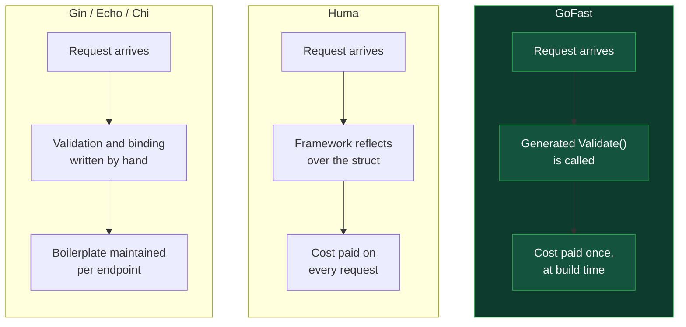
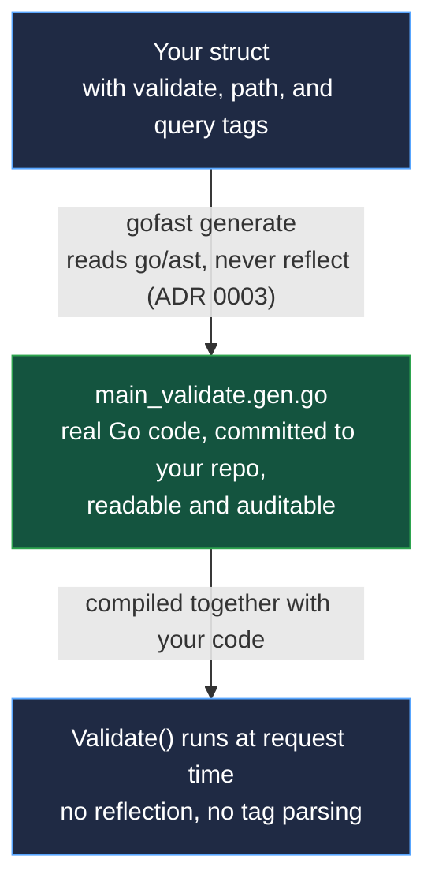
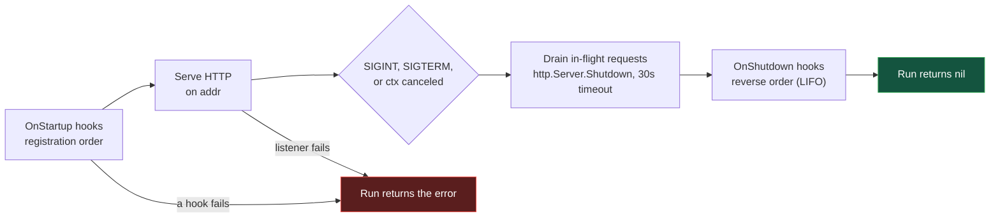
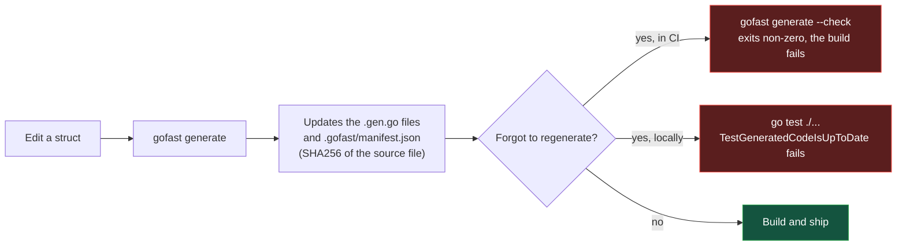
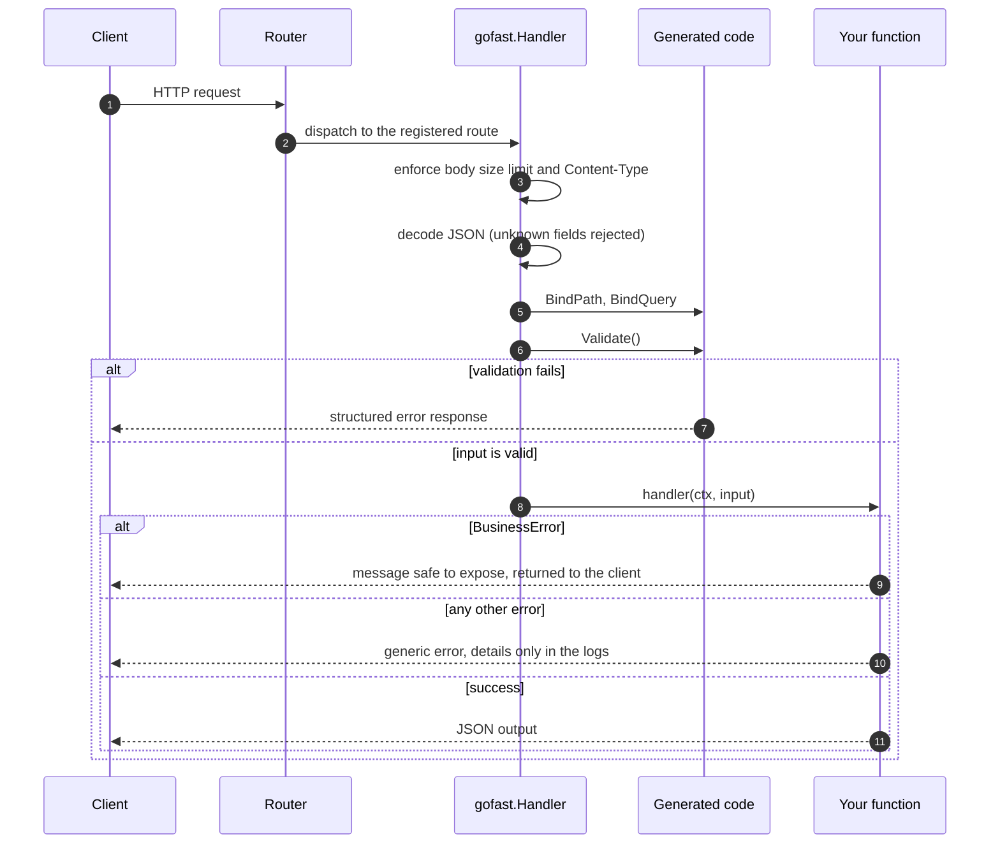
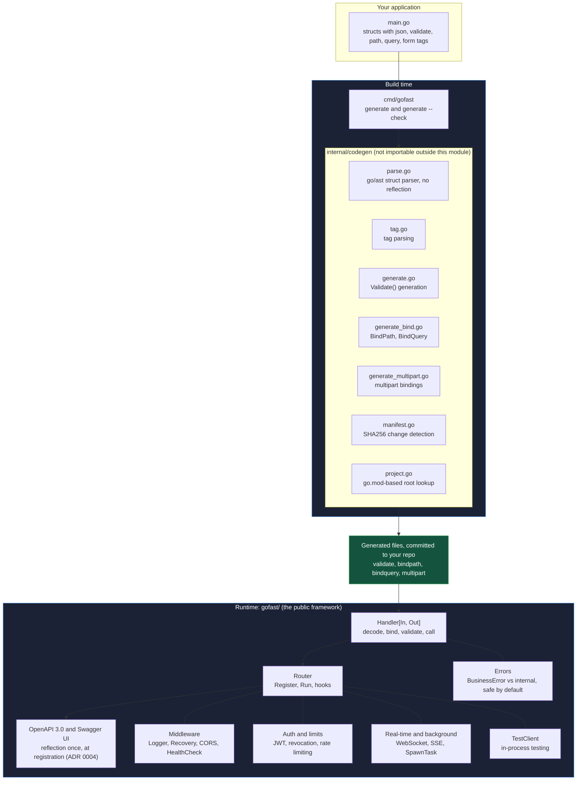

# GoFast

**Request validation, binding, and OpenAPI documentation for Go, generated at build time from your structs. Not resolved by reflection on every request.**

[](https://github.com/Darkblade1995/gofast/actions/workflows/ci.yml)


Write a struct with tags. GoFast reads it once, at build time, through `go/ast`, and writes real, readable Go code into your repository that validates, binds, and documents your API. Nothing is decided at request time that could have been decided at compile time.

---

## At a glance

| Measure | Result | Where to verify |
|---|---|---|
| Validation in isolation vs Huma | up to **~37.5x faster**, 0 allocations vs 3 | [Benchmarks](#benchmarks) |
| Full HTTP request vs Huma | **~1.49x** sequential, **~1.05x** under 12-thread load | [Benchmarks](#benchmarks) |
| Allocations in a full HTTP cycle | **39 vs 53** (about 26% fewer) | [Benchmarks](#benchmarks) |
| Reflection per request | **none** in validation or binding | [ADR 0001](docs/adr/0001-build-time-codegen-vs-runtime-reflection.md), [ADR 0003](docs/adr/0003-ast-parsing-not-reflect-for-codegen.md) |
| Stale generated code reaching production | **blocked** by `gofast generate --check` in CI | [Verification loop](#the-build-time-verification-loop) |
| Documented architecture decisions | **18** | [Design decisions](#design-decisions-adrs) |
| AST parser fuzzing | **2M+ executions, 0 panics** | [Engineering rigor](#engineering-rigor) |

## Highlights

| Capability | What it means in practice |
|---|---|
| Build-time, not request-time | The work Huma does on every request, GoFast does once, when you run `gofast generate`. |
| Generated code you can read | The output is a `.gen.go` file in your own repo and your own git diff. Nothing hidden behind a framework abstraction. |
| Stale generation cannot ship | A manifest stores a SHA256 of each source file. `--check` fails CI, and a test fails locally, if you forgot to regenerate. |
| Safe-by-default errors | Internal errors are logged and never leak to clients unless you mark an error as a `BusinessError`. |
| Production plumbing included | JWT with refresh tokens and optional revocation, rate limiting, graceful lifecycle, WebSockets, SSE, background tasks, and an in-process test client. |
| Every choice has a written reason | 18 Architecture Decision Records, including the ones that limit what GoFast can honestly claim. |

---

## Table of contents

- [The problem](#the-problem)
- [The bet](#the-bet)
- [Quick start](#quick-start)
- [How it works](#how-it-works)
- [Request lifecycle](#request-lifecycle)
- [Architecture](#architecture)
- [Feature matrix](#feature-matrix)
- [Benchmarks](#benchmarks)
- [Engineering rigor](#engineering-rigor)
- [Design decisions (ADRs)](#design-decisions-adrs)
- [Why not just use Huma?](#why-not-just-use-huma)
- [Known limits](#known-limits)
- [Project status](#project-status)
- [Repository layout](#repository-layout)
- [License](#license)

---

## The problem

Go has strong HTTP routers (Gin, Echo, Chi) and at least one framework that automates validation and OpenAPI generation the way FastAPI does for Python: [Huma](https://github.com/danielgtaylor/huma).

None of them generate that automation **at build time**, as real files you can open, read, and audit. They either require you to write validation and binding by hand, or they resolve it through reflection on every incoming request.



## The bet

GoFast's bet is narrow and specific: eliminate the same boilerplate Huma eliminates, but pay the reflection cost once, at build time, instead of on every request, and keep the generated result fully visible in your own repository instead of hidden inside the framework.



This is what the generator writes for the `LoginInput` struct from the quick start below:

```go
// Code generated by gofast. DO NOT EDIT.

package main

import (
	"fmt"
	"strings"
)

func (in LoginInput) Validate() error {
	if in.Email == "" {
		return fmt.Errorf("Email is required")
	}
	if !strings.Contains(in.Email, "@") {
		return fmt.Errorf("Email must be a valid email")
	}
	if in.Password == "" {
		return fmt.Errorf("Password is required")
	}
	if len(in.Password) < 8 {
		return fmt.Errorf("Password must be at least 8 characters")
	}
	return nil
}
```

This is not a theoretical claim. It is measured. See [Benchmarks](#benchmarks).

---

## Quick start

```go
package main

import (
	"context"
	"log"
	"net/http"
	"time"

	"github.com/Darkblade1995/gofast/gofast"
)

type LoginInput struct {
	Email    string `json:"email" validate:"required,email"`
	Password string `json:"password" validate:"required,min=8"`
}

type LoginOutput struct {
	Token string `json:"token"`
}

func Login(ctx context.Context, in LoginInput) (LoginOutput, error) {
	return LoginOutput{Token: "token-for-" + in.Email}, nil
}

func main() {
	router := gofast.NewRouter()
	router.Register("POST", "/login", gofast.Handler(Login))

	server := &http.Server{
		Addr:              ":8080",
		Handler:           router,
		ReadTimeout:       10 * time.Second,
		WriteTimeout:      10 * time.Second,
		IdleTimeout:       60 * time.Second,
		ReadHeaderTimeout: 5 * time.Second,
	}

	log.Println("server running on :8080")
	log.Fatal(server.ListenAndServe())
}
```

Generate the validation code for that struct:

```bash
go run ./cmd/gofast generate ./main.go
```

This writes a real `main_validate.gen.go` next to your code. `LoginInput` now implements `Validate()` automatically, and `gofast.Handler` picks it up without any extra wiring.

### Graceful shutdown with `router.Run`

The example above builds an `http.Server` by hand. `router.Run` is an optional alternative that also manages the lifecycle (see [ADR 0012](docs/adr/0012-lifespan-hooks-router-run.md)).

```go
func main() {
	router := gofast.NewRouter()
	router.Register("POST", "/login", gofast.Handler(Login))

	if err := router.Run(context.Background(), ":8080", nil); err != nil {
		log.Fatal(err)
	}
}
```



Two details worth knowing:

| Detail | Why it matters |
|---|---|
| `Run` takes three arguments: `Run(ctx, addr, handler)` | Pass `nil` as the handler to serve the router directly, or a middleware chain wrapping it. |
| `Run` returns `nil` after a clean shutdown | Do not wrap it directly in `log.Fatal(router.Run(...))`: `log.Fatal` exits with status 1 even when given `nil`. Check the error as shown above. |

`Run` creates its own `http.Server` and does not set read, write, or idle timeouts. If you need them, use the manual `http.Server` form shown earlier.

---

## How it works

### Three tags, three generated behaviors

| Tag | Generates | Example |
|---|---|---|
| `validate:"..."` | `Validate() error` | `validate:"required,email"` |
| `path:"..."` | `BindPath(map[string]string)` | `path:"id"` |
| `query:"..."` | `BindQuery(url.Values)` | `query:"page,default=1"` |

```go
type GetAccountInput struct {
	ID string `path:"id"`
}

type ListTransactionsInput struct {
	Page  int `query:"page,default=1"`
	Limit int `query:"limit,default=10"`
}
```

### Validation rules supported today

| Rule | Applies to | Behavior |
|---|---|---|
| `required` | any field | rejects empty/zero value |
| `email` | string | checks for `@` |
| `min=N` / `max=N` | string | length bounds |
| `dive,<rule>` | `[]string` | applies `<rule>` to every element |
| `dive_key,<rule>` | `map[string]V` | applies `<rule>` to every key |
| nested struct, `*struct`, `[]struct`, `map[K]struct` | any field whose type also has `Validate()` | recurses automatically, at any depth |

Rules not in this table are not implemented. See [Known limits](#known-limits).

### The build-time verification loop



A stale generation cannot silently ship.

---

## Request lifecycle

What happens to a request once it reaches a registered route.



---

## Architecture



---

## Feature matrix

Every capability below is built, tested, and backed by the linked ADR where one exists. What is deliberately absent is listed in [Known limits](#known-limits).

### Contract, binding, and validation

| Capability | Detail | ADR |
|---|---|---|
| Core contract | `Handler[In, Out]`, generics-based, with `context.Context` | none |
| Path and query binding | path params, query params with defaults, generated at build time | [0001](docs/adr/0001-build-time-codegen-vs-runtime-reflection.md) |
| JSON request bodies | decoded with `DisallowUnknownFields` | none |
| Multipart/form-data | file uploads via `form:"..."` tag, build-time codegen, zero runtime reflection | [0017](docs/adr/0017-multipart-form-data-build-time-codegen.md) |
| Validation | required, email, min/max, nested structs, slice and map `dive` | [0003](docs/adr/0003-ast-parsing-not-reflect-for-codegen.md) |

### Code generation

| Capability | Detail | ADR |
|---|---|---|
| AST-based generator | zero reflection, parses source with `go/ast` | [0003](docs/adr/0003-ast-parsing-not-reflect-for-codegen.md) |
| Hash-verified manifest | SHA256 per source file, safe under concurrent `gofast generate` runs | [0018](docs/adr/0018-manifest-concurrent-write-safety.md) |
| Staleness detection | `gofast generate --check` for CI, plus a local test | [0001](docs/adr/0001-build-time-codegen-vs-runtime-reflection.md) |
| Generated code type-checked in tests | `go/types` runs over the output, catching unused imports and variables | none |

### HTTP layer and documentation

| Capability | Detail | ADR |
|---|---|---|
| Middleware | Logger, Recovery (panic-safe), CORS | none |
| Health checks | `router.HealthCheck` | none |
| Errors | structured, typed, safe by default (`BusinessError`) | none |
| OpenAPI 3.0 | generated from registered routes, served with Swagger UI | [0004](docs/adr/0004-reflection-allowed-for-openapi-not-request-validation.md) |
| Migration path | mount GoFast beside Gin, Echo, or Huma via `http.Handler` | [0007](docs/adr/0007-migration-path-from-gin-echo-huma.md) |

### Security

| Capability | Detail | ADR |
|---|---|---|
| JWT authentication | stateless validation, context propagation | [0008](docs/adr/0008-jwt-auth-context-propagation.md) |
| Refresh tokens | stateless, no rotation | [0009](docs/adr/0009-refresh-tokens-stateless-no-rotation.md) |
| Token revocation | pluggable interface, Redis reference implementation | [0010](docs/adr/0010-token-revocation-pluggable-interface.md) |
| Rate limiting | pluggable interface, in-memory and Redis implementations | [0011](docs/adr/0011-rate-limiting-pluggable-interface.md) |
| Request hardening | body size limits, Content-Type validation | none |

### Operability and real-time

| Capability | Detail | ADR |
|---|---|---|
| Lifecycle | `OnStartup` and `OnShutdown` hooks, optional `Router.Run` for orchestrated graceful shutdown | [0012](docs/adr/0012-lifespan-hooks-router-run.md) |
| Background work | `SpawnTask` via context injection, coordinated with graceful shutdown | [0014](docs/adr/0014-background-tasks-via-context.md) |
| WebSockets | `Router.RegisterWS` on `coder/websocket`, a separate handler contract | [0013](docs/adr/0013-websocket-support-coder-websocket.md) |
| Server-Sent Events | `Router.RegisterSSE`, a separate handler contract | [0016](docs/adr/0016-streaming-responses-sse.md) |
| Testing | built-in `TestClient`: in-process, JSON bodies, auth token helper | [0015](docs/adr/0015-testclient-httptest-recorder.md) |

Full detail, including everything explicitly out of scope and why: [`docs/ROADMAP.md`](docs/ROADMAP.md).

---

## Benchmarks

Measured against Huma v2.39.1 in four scenarios. Full methodology and reproduction commands are in [`docs/BENCHMARKS.md`](docs/BENCHMARKS.md). Bars are proportional within each scenario, and shorter is better.

| Scenario | Framework | Time per operation | ns/op | Allocs | Advantage |
|---|---|---|---|---|---|
| Isolated validation, simple struct | GoFast | `█` | 2.123 | 0 | **~37.5x** |
| | Huma | `██████████████████████████████` | 79.53 | 3 | |
| Isolated validation, nested + slice | GoFast | `██` | 4.367 | 0 | **~19.6x** |
| | Huma | `██████████████████████████████` | 85.69 | 3 | |
| Full HTTP cycle, sequential | GoFast | `████████████████████` | 4400 | 39 | **~1.49x** |
| | Huma | `██████████████████████████████` | 6549 | 53 | |
| Full HTTP cycle, concurrent (12 threads) | GoFast | `█████████████████████████████` | 2715 | 39 | **~1.05x** |
| | Huma | `██████████████████████████████` | 2850 | 53 | |

### How to read these numbers

| Observation | Explanation |
|---|---|
| The isolated advantage shrinks sharply in a real request | JSON decoding and Go's own runtime (allocator, garbage collector) dominate the cost budget for both frameworks equally. |
| GoFast's generated code is not the bottleneck | CPU profiling shows it does not appear among the top 15 CPU consumers in a full HTTP cycle. The runtime and JSON encoding do. |
| Allocations are the advantage that survives | In isolated validation GoFast allocates nothing (0 vs 3). In full HTTP cycles, sequential and concurrent, it makes 39 allocations against Huma's 53, about **26% fewer**. |
| The concurrent gap is small | At ~1.05x under 12-thread load, the honest summary is "comparable speed, fewer allocations". |

```bash
cd benchmarks
go test -bench=BenchmarkGoFastHTTPCycle -benchmem ./...
go test -bench=BenchmarkHumaHTTPCycle -benchmem ./...
```

---

## Engineering rigor

| Practice | Detail |
|---|---|
| Static analysis | `golangci-lint` and `govulncheck`, both clean |
| Race detection | the full suite runs under `go test -race` |
| Fuzzing | the AST parser has been fuzzed for 2M+ executions with 0 panics |
| Generated code is type-checked | tests run `go/types` over the generator's output, not just a syntax check |
| Stale-generation guard | `gofast generate --check` in CI plus `TestGeneratedCodeIsUpToDate` locally |
| Profiling | CPU and memory profiling results are documented in [`docs/BENCHMARKS.md`](docs/BENCHMARKS.md) |
| Bugs are documented | every bug found during development is recorded in [`docs/ROADMAP.md`](docs/ROADMAP.md) with its cause, its fix, and the test that now catches it |
| Decisions are written down | 18 ADRs, never edited retroactively: a changed decision gets a new ADR that supersedes the old one |

---

## Design decisions (ADRs)

Every non-obvious architectural choice is documented as an ADR, including the ones that constrain what GoFast can honestly claim.

| ADR | Area | Decision |
|---|---|---|
| [0001](docs/adr/0001-build-time-codegen-vs-runtime-reflection.md) | Core | Build-time codegen instead of runtime reflection |
| [0002](docs/adr/0002-router-registration-not-concurrency-safe.md) | Router | Route registration is startup-only, not concurrency-safe |
| [0003](docs/adr/0003-ast-parsing-not-reflect-for-codegen.md) | Codegen | The generator parses `go/ast`, never uses `reflect` |
| [0004](docs/adr/0004-reflection-allowed-for-openapi-not-request-validation.md) | OpenAPI | Reflection is allowed once, at route registration, for OpenAPI, not per request |
| [0005](docs/adr/0005-semantic-versioning-policy-pre-v1.md) | Versioning | Semantic versioning policy before v1.0.0 |
| [0006](docs/adr/0006-dependency-injection-via-explicit-closures.md) | Design | Dependency injection via explicit closures, no container |
| [0007](docs/adr/0007-migration-path-from-gin-echo-huma.md) | Adoption | Migration path from Gin/Echo/Huma via `http.Handler` mounting |
| [0008](docs/adr/0008-jwt-auth-context-propagation.md) | Auth | JWT auth: stateless validation and context propagation |
| [0009](docs/adr/0009-refresh-tokens-stateless-no-rotation.md) | Auth | Refresh tokens: stateless, no rotation |
| [0010](docs/adr/0010-token-revocation-pluggable-interface.md) | Auth | Token revocation: pluggable interface, Redis reference implementation |
| [0011](docs/adr/0011-rate-limiting-pluggable-interface.md) | Security | Rate limiting: pluggable interface, in-memory and Redis implementations |
| [0012](docs/adr/0012-lifespan-hooks-router-run.md) | Lifecycle | Lifespan hooks: `Router.Run` built on net/http's graceful shutdown |
| [0013](docs/adr/0013-websocket-support-coder-websocket.md) | Real-time | WebSocket support: coder/websocket, a separate handler contract |
| [0014](docs/adr/0014-background-tasks-via-context.md) | Lifecycle | Background tasks: TaskRunner injected via context, coordinated with lifespan shutdown |
| [0015](docs/adr/0015-testclient-httptest-recorder.md) | Testing | Built-in TestClient: `httptest.Recorder`, not a real server |
| [0016](docs/adr/0016-streaming-responses-sse.md) | Streaming | Streaming responses: Server-Sent Events, a separate handler contract |
| [0017](docs/adr/0017-multipart-form-data-build-time-codegen.md) | Codegen | Multipart/form-data: build-time codegen, consistent with ADR 0001 |
| [0018](docs/adr/0018-manifest-concurrent-write-safety.md) | Codegen | Manifest concurrent writes: version counter plus optimistic conflict retry under a mutex |

---

## Why not just use Huma?

Huma already provides FastAPI-style automatic validation and OpenAPI generation for Go, and it is a mature, well-adopted project. GoFast is not trying to replace it. It tests a narrower architectural bet: that the same automation can cost nothing at request time, because the work happens once, at build time, in code that stays visible in your own repository.

| | Gin / Echo / Chi | Huma | GoFast |
|---|---|---|---|
| Automatic validation from struct tags | typically manual, or add-on libraries | yes | yes |
| OpenAPI generation | not built in | yes | yes (OpenAPI 3.0) |
| When the validation work happens | written by hand | on every request, via reflection | once, at build time |
| Validation code visible in your repo | only what you write | no, it lives inside the framework | yes, generated `.gen.go` files |
| Stale generation guard | not applicable | not applicable | `--check` in CI plus a local test |
| Maturity | very mature | mature, widely adopted | pre-v1.0.0, API still moving |

The evidence for the bet, including where it holds and where it does not, is in [`docs/BENCHMARKS.md`](docs/BENCHMARKS.md). The explicit limits of what GoFast claims are in [`docs/VISION.md`](docs/VISION.md).

---

## Known limits

GoFast documents what it does not do with the same care as what it does.

| Limit | Detail |
|---|---|
| Pre-v1.0.0 API | Minor versions may still break the core contract until the API has proven stable across two consecutive releases (ADR 0005). `Handler[In, Out]` has already changed twice. |
| Unknown validation rules are ignored | A rule the generator does not implement, or a typo such as `reqired`, generates no check. Whether the generator should fail loudly is tracked in the roadmap. |
| WebSocket and SSE routes are not in the OpenAPI spec | OpenAPI 3.0 has no native support for them. This gap is accepted and documented. |
| No dependency injection container | Intentional. Dependencies are passed through explicit closures (ADR 0006). |
| Route registration is startup-only | `Register` is not safe for concurrent use or after the server starts (ADR 0002). |
| Not a full application framework | No ORM, no templating, no admin panel (see [`docs/VISION.md`](docs/VISION.md)). |
| Not a claim of maximum performance | It is a specific bet about where reflection cost is paid. In a full HTTP cycle the measured advantage is modest. |

---

## Project status

GoFast is **pre-v1.0.0**. Its versioning policy (ADR 0005) is explicit: minor versions may still break the core contract until the API has proven stable across two consecutive releases. The `Handler[In, Out]` contract has already changed twice during development, once to add `context.Context` and once to carry reflected type information for OpenAPI.

See [`docs/ROADMAP.md`](docs/ROADMAP.md) for the complete, continuously updated state of every phase, including known risks and design decisions still open.

---

## Repository layout

```text
gofast/                     the public framework package
  handler.go                Handler[In, Out], the core contract
  router.go                 Router, functional options, lifecycle (Run)
  middleware.go             Logger, Recovery, CORS
  errors.go                 error types, BusinessError
  health.go                 HealthCheck
  openapi.go                OpenAPI 3.0 generation
  docs.go                   Swagger UI serving
  auth.go                   JWT authentication
  revocation.go             token revocation interface
  ratelimit.go              rate limiting interface
  multipart.go              multipart/form-data handling
  websocket.go              WebSocket support
  sse.go                    Server-Sent Events
  tasks.go                  background tasks
  testclient.go             in-process TestClient
  ratelimit/memory/         in-memory rate limiter
  ratelimit/redis/          Redis-backed rate limiter
  revocation/redis/         Redis-backed token revocation

internal/codegen/           the code generator (not importable outside this module)

cmd/gofast/                 the CLI (gofast generate [--check])

benchmarks/                 isolated module measuring GoFast against Huma
                            (own go.mod, replace directive; Huma is never
                            a dependency of GoFast itself)

examples/minimal/           a working example, also used as the generator's
                            own integration test target

docs/
  adr/                      architecture decision records
  VISION.md                 project philosophy and limits
  ROADMAP.md                live status of every phase
  BENCHMARKS.md             reproducible performance evidence, methodology,
                            and profiling results
```

---

## License

MIT. See [LICENSE](LICENSE) for details.